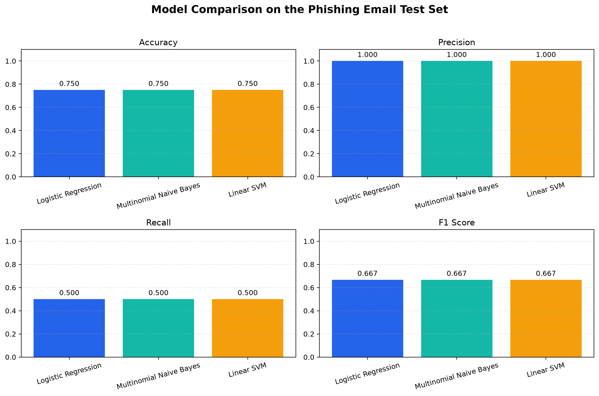
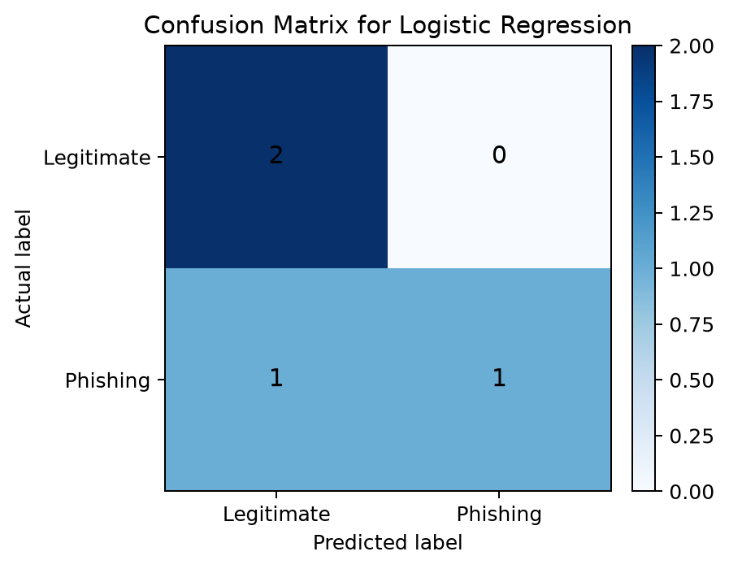

# Final ML Evaluation Report

## Project context
This report uses the project's prepared phishing email dataset and the same train/test split and TF-IDF preprocessing pipeline used for all model evaluations.

- Dataset file: `C:\Users\User\OneDrive\Desktop\main project\ml\data\processed\clean_phishing_emails.csv`
- Rows after cleaning: 18
- Training samples: 14
- Testing samples: 4
- Random state: 42
- TF-IDF vectorizer fitted only on the training data to prevent leakage.

## Evaluation methodology
The same split and evaluation workflow was applied to every model:

1. Split the cleaned dataset into 80% training and 20% testing using stratification.
2. Fit the TF-IDF vectorizer only on training text.
3. Transform both training and test data with the fitted vectorizer.
4. Train each model on the training set.
5. Evaluate on the same unseen test set.

## Model comparison results

| Model | Accuracy | Precision | Recall | F1-score |
|---|---:|---:|---:|---:|
| Logistic Regression | 0.7500 | 1.0000 | 0.5000 | 0.6667 |
| Multinomial Naive Bayes | 0.7500 | 1.0000 | 0.5000 | 0.6667 |
| Linear SVM | 0.7500 | 1.0000 | 0.5000 | 0.6667 |



## Best model selected for deployment
The best-performing model on this dataset is: Logistic Regression.

This selection is based on the actual evaluation metrics above. On the current test set, all three models achieved the same accuracy, precision, recall, and F1-score, so the project uses the simplest and most interpretable option: Logistic Regression.

For phishing detection, recall is especially important because a false negative means a phishing email may be treated as legitimate. Precision remains high (1.0000), which means the selected model is conservative in labeling messages as phishing. The current dataset is small, so this tie should be revisited with a larger dataset in future work.

## Confusion matrix for the selected model
Rows = actual labels [legitimate, phishing]
Columns = predicted labels [legitimate, phishing]

```text
[[2 0]
 [1 1]]
```



## Summary
- Accuracy: 0.7500
- Precision: 1.0000
- Recall: 0.5000
- F1-score: 0.6667

These values were generated directly from the actual test set and the trained models; no values were fabricated.
